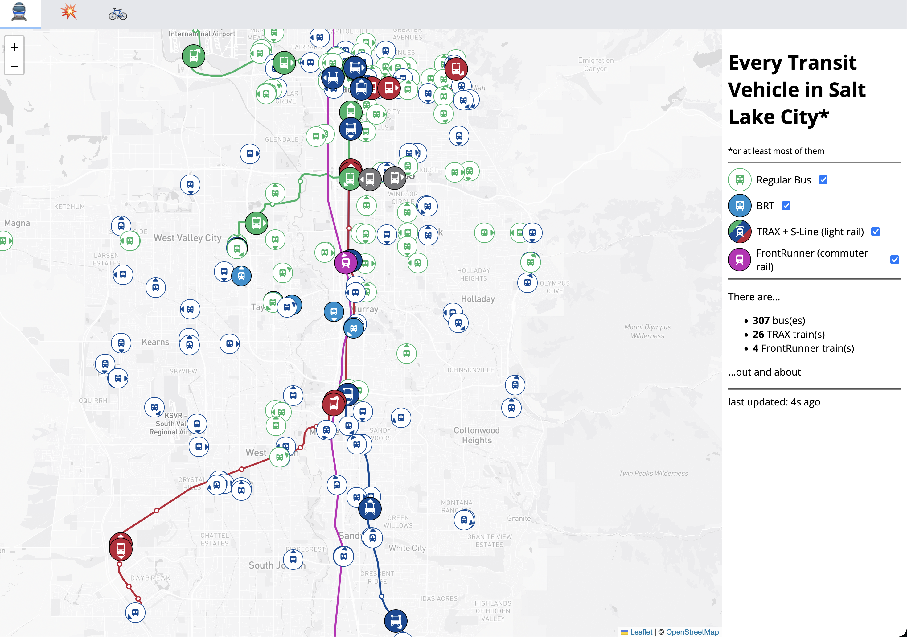

# UTA tracker

Tracking all the trains & buses in Salt Lake City.

## API

- `GET https://uta.clb.li/api.json`: List all vehicles currently in service (JSON)
- `GET https://uta.clb.li/api`: Same as above, but Protobuf (see )
- `GET https://uta.clb.li/api/shapes/{shape_id}`: Get the geographic route "shape" for a given vehicle's `shape_id`

